<p align="center">
  
</p>

<p align="center">
  <a href="https://github.com/Normansrule/robot-rescue/releases/latest"></a>
  <a href="https://normansrule.github.io/robot-rescue/"></a>
  
  
</p>
<p align="center">
  
  
  
  
  
  
</p>

**ROBOT RESCUE** is a cute co-op physics-puzzle game. You build your own little rescue bot (**PIP** is the default), the newest recruit at the Robot Rescue Bureau,
a little space station in orbit. **DISPATCH** fires you down in mission pods to save people from everyday disasters:
pasta that won't cook, a coffee machine that's about to blow, a food critic who's about to write a terrible review.
And someone keeps sending an S.O.S. from under the sea. ([Setting and story](docs/STORY.md))

<p align="center">
  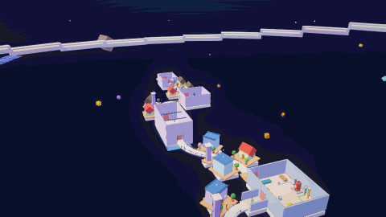
  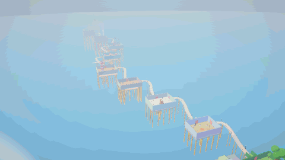
</p>
<p align="center">
  
  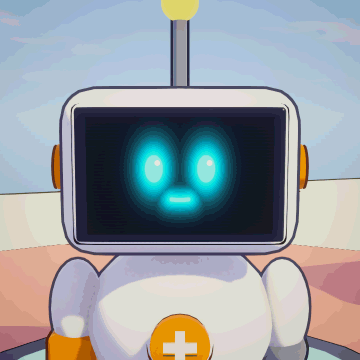
  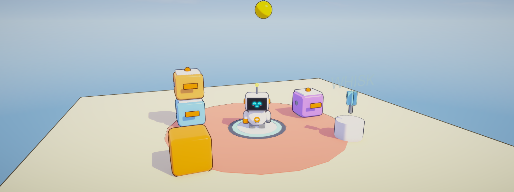
</p>


## Progress tracker

<p align="center"></p>

<p align="center"></p>

### Level by level

What each column means: **Code** written · **Builds** = the one-click builder makes the scene in Unity 6.6 with no
errors · **Filmed** = a scripted Play Mode run recorded the GIF below (click to open it) · **Self-test** = an automated
check of the puzzle rules · **Playtested** = a person played it start to finish and wrote it up · **Released** = in the
latest download.

| Level | Code | Builds | Filmed | Self-test | Playtested | Released |
|---|:-:|:-:|:-:|:-:|:-:|:-:|
| Training 1: Stack 'Em Up | ✅ | ✅ | [✅](docs/media/gameplay/Test01_StackEmUp.gif) | ⬜ | ⬜ | ✅ |
| Training 2: Conveyor Caper | ✅ | ✅ | [✅](docs/media/gameplay/Test02_ConveyorCaper.gif) | ⬜ | ⬜ | ✅ |
| Training 3: Swing Shift | ✅ | ✅ | [✅](docs/media/gameplay/Test03_SwingShift.gif) | ⬜ | ⬜ | ✅ |
| Big Rescue: Coffee Crisis | ✅ | ✅ | [✅](docs/media/gameplay/Ch1_Boss_CoffeeCrisis.gif) | ⬜ | ⬜ | ✅ |
| Call 2-1: Pasta Emergency | ✅ | ✅ | [✅](docs/media/gameplay/Ch2_Call01_PastaEmergency.gif) | ⬜ | ⬜ | ✅ |
| Call 2-2: Whisk Business | ✅ | ✅ | [✅](docs/media/gameplay/Ch2_Call02_WhiskBusiness.gif) | ⬜ | ⬜ | ✅ |
| Big Rescue: Pasta Panic | ✅ | ✅ | [✅](docs/media/gameplay/Ch2_Boss_PastaPanic.gif) | ⬜ | ⬜ | ✅ |
| Call 3-1: Loose Screws | ✅ | ✅ | [✅](docs/media/gameplay/Ch3_Call01_LooseScrews.gif) | ⬜ | ⬜ | ⬜ |
| Big Rescue: Up a Tree | ✅ | ✅ | [✅](docs/media/gameplay/Ch3_Boss_UpATree.gif) | ⬜ | ⬜ | ⬜ |
| Call 4-1: Catch the Hum | ✅ | ✅ | [✅](docs/media/gameplay/Ch4_Call01_CatchTheHum.gif) | ⬜ | ⬜ | ⬜ |
| Big Rescue: Slightly Too Big | ✅ | ✅ | [✅](docs/media/gameplay/Ch4_Boss_SlightlyTooBig.gif) | ⬜ | ⬜ | ⬜ |
| Call 5-1: Heavy Lifting | ✅ | ✅ | [✅](docs/media/gameplay/Ch5_Call01_HeavyLifting.gif) | ⬜ | ⬜ | ⬜ |
| Big Rescue: Lights Out | ✅ | ✅ | [✅](docs/media/gameplay/Ch5_Boss_LightsOut.gif) | ⬜ | ⬜ | ⬜ |
| Call 6-1: Carousel Chaos | ✅ | ✅ | [✅](docs/media/gameplay/Ch6_Call01_CarouselChaos.gif) | ⬜ | ⬜ | ⬜ |
| Big Rescue: Stuck at the Top | ✅ | ✅ | [✅](docs/media/gameplay/Ch6_Boss_StuckAtTheTop.gif) | ⬜ | ⬜ | ⬜ |
| Call 7-1: Going Down | ✅ | ✅ | [✅](docs/media/gameplay/Ch7_Call01_GoingDown.gif) | ⬜ | ⬜ | ⬜ |
| Big Rescue: Unit Zero | ✅ | ✅ | [✅](docs/media/gameplay/Ch7_Boss_UnitZero.gif) | ⬜ | ⬜ | ⬜ |
| Call 8-1: Stage Fright | ✅ | ✅ | [✅](docs/media/gameplay/Ch8_Call01_StageFright.gif) | ⬜ | ⬜ | ⬜ |
| Big Rescue: The Founders' Song | ✅ | ✅ | [✅](docs/media/gameplay/Ch8_Boss_TheFoundersSong.gif) | ⬜ | ⬜ | ⬜ |
| Side call: The Pump House | ✅ | ✅ | ⬜ | [✅ 21/21](docs/slices/pump-house/selftest-last.txt) | ⬜ | ⬜ |

### Done, in progress, planned

| ✅ Done and checked in Unity | 🔧 Built, still to test | 🗺️ Planned |
|---|---|---|
| Core bot: move, jump, climb, carry, throw | **Reserve battery** (walk slowly to a charger when flat) | Co-op for 2-4 bots (online + couch) |
| Tether: power, pull, swing | **Lost parts**: marker, float in water, come home | Rescue Rush (timed, shuffled tasks) |
| Tools: Whisk, Screwdriver, Magnet | Room resets + layered hints (Pump House only so far) | Hand-made models, music and sound |
| Chapters 1-8, 8 Big Rescues, ending credits | Next release with Chapters 3-8 | Room resets + hints in every chapter |
| Bureau Station + Brightwater Reach worlds | Fixes for bridges and backwards signs (in progress) | Customization rewards, Paint Bay |
| Customizable bots (4 save slots) | First full playtest of every call | Later pods: Moon Mine, Jungle Lab |
| Pump House side call, self-test 21/21 | | Mac and Linux builds |

The day-by-day log is in [docs/PROGRESS.md](docs/PROGRESS.md); the design rules are in [docs/DESIGN.md](docs/DESIGN.md).

## The campaign map

<p align="center"></p>

## See it running

Every clip below was recorded **inside Unity in Play Mode** by `Robot Rescue > Capture Gameplay`, which presses Play on
each level and drives the bot with a virtual keyboard. Chapters 1-4 were filmed on 12 Oct, Chapter 5 on 14 Oct and
Chapters 6-8 on 18 Oct. The look is still the procedural prototype (no hand-made art yet).

<table>
<tr>
<td width="50%" align="center"><b>Main menu</b><br>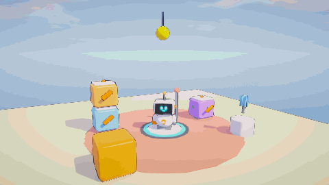</td>
<td width="50%" align="center"><b>Customize your bot</b><br>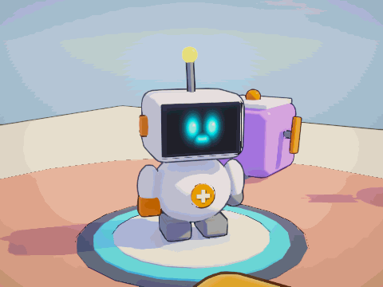</td>
</tr>
<tr>
<td width="50%" align="center"><b>Bureau Station (hub)</b><br>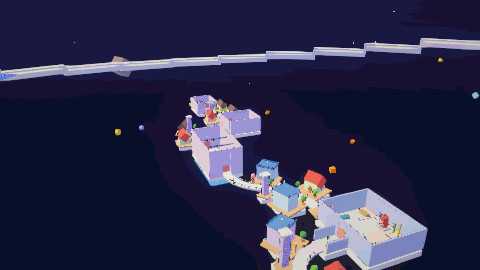</td>
<td width="50%" align="center"><b>Brightwater Reach (sea city)</b><br>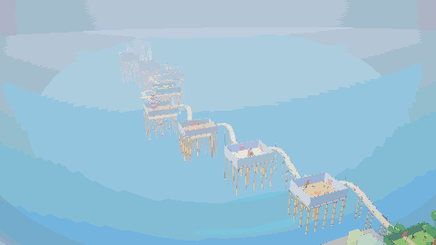</td>
</tr>
<tr>
<td width="50%" align="center"><b>Training 1: Stack 'Em Up</b><br>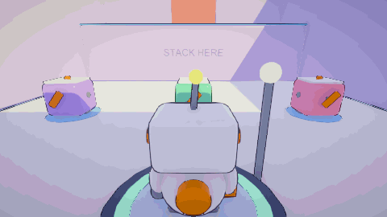</td>
<td width="50%" align="center"><b>Training 2: Conveyor Caper</b><br>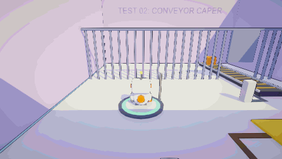</td>
</tr>
<tr>
<td width="50%" align="center"><b>Training 3: Swing Shift</b><br>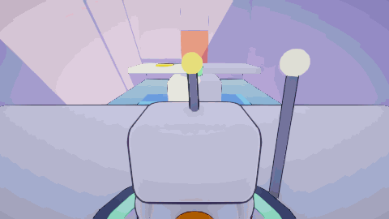</td>
<td width="50%" align="center"><b>Big Rescue: Coffee Crisis</b><br>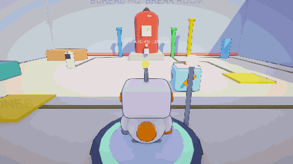</td>
</tr>
<tr>
<td width="50%" align="center"><b>Call 2-1: Pasta Emergency</b><br>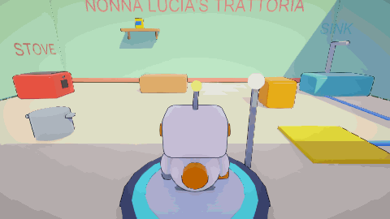</td>
<td width="50%" align="center"><b>Call 2-2: Whisk Business</b><br>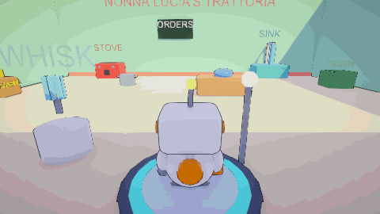</td>
</tr>
<tr>
<td width="50%" align="center"><b>Big Rescue: Pasta Panic</b><br>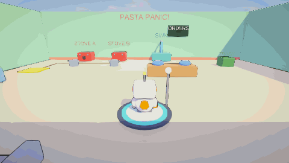</td>
<td width="50%" align="center"><b>Call 3-1: Loose Screws</b><br>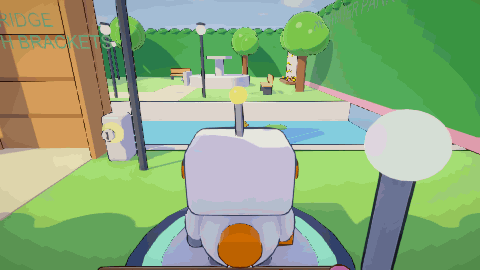</td>
</tr>
<tr>
<td width="50%" align="center"><b>Big Rescue: Up a Tree</b><br>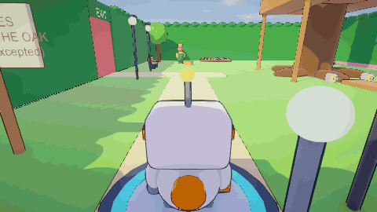</td>
<td width="50%" align="center"><b>Call 4-1: Catch the Hum</b><br>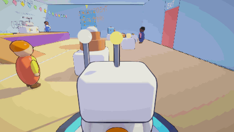</td>
</tr>
<tr>
<td width="50%" align="center"><b>Big Rescue: Slightly Too Big</b><br>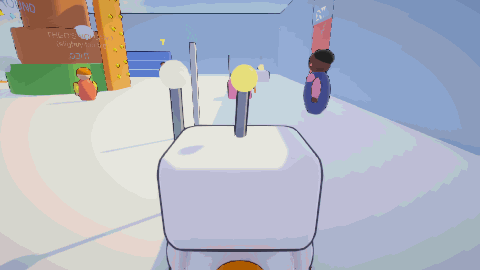</td>
<td width="50%" align="center"><b>Call 5-1: Heavy Lifting</b><br>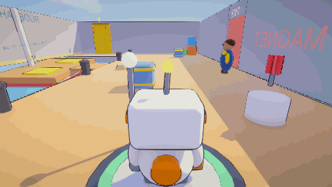</td>
</tr>
<tr>
<td width="50%" align="center"><b>Big Rescue: Lights Out</b><br>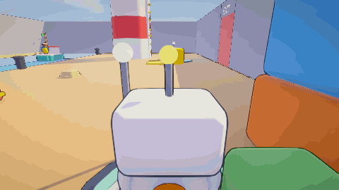</td>
<td width="50%" align="center"><b>Call 6-1: Carousel Chaos</b><br>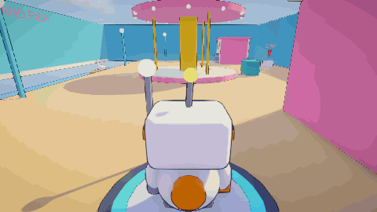</td>
</tr>
<tr>
<td width="50%" align="center"><b>Big Rescue: Stuck at the Top</b><br>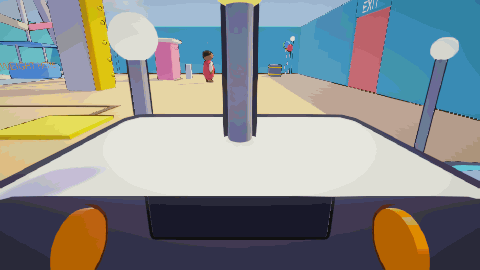</td>
<td width="50%" align="center"><b>Call 7-1: Going Down</b><br>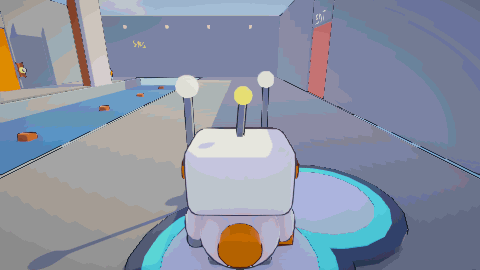</td>
</tr>
<tr>
<td width="50%" align="center"><b>Big Rescue: Unit Zero</b><br>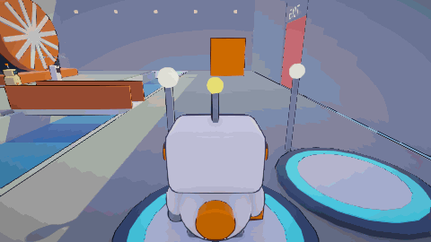</td>
<td width="50%" align="center"><b>Call 8-1: Stage Fright</b><br>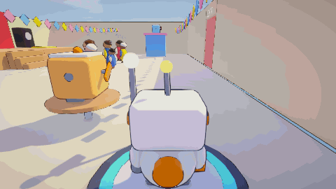</td>
</tr>
<tr>
<td width="50%" align="center"><b>Big Rescue: The Founders' Song</b><br>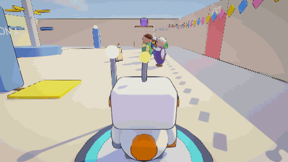</td>
<td width="50%" align="center"><b>Side call: The Pump House</b><br><i>Not filmed yet. Run <b>Robot Rescue &gt; Capture Gameplay</b> in Unity.</i></td>
</tr>
</table>

## What's in the game

- **Toy-like 3D look**: rounded, outlined toon shading, a painted sky, soft fog and bloom.
- **Personalities**: PIP has an LED face with moods, a wobbly head and a little chirpy voice. Every Helper Drone has a
  name and a temperament (cheerful, nervous, grumpy, sleepy, show-off) and reacts to you. Press **G** to wave.
- **Missions by pod**: the Bureau Station is the hub. Finish Chapter 1 and the Launch Bay pod flies you down to
  **Brightwater Reach**, a floating city of ocean rigs. Inside each place there are no loading screens: finish a
  call and the bridge to the next gate powers up, all the way from the trattoria to the Founders' Festival on the summit.
- **The Hum**: something under the sea keeps sending an S.O.S. Golden bolts are memory bolts: each one you find plays
  the next log from Unit Zero, the Bureau's very first bot.
- **Battery**: PIP's battery drains while it moves, faster when running, climbing, using tools or powering things.
  Standing still is free. Recharge on glowing service bays, plug the Tether into green charger posts, or carry a Helper
  Drone to borrow its charge. Run flat and you're on **reserve**: you can still walk slowly, carry things and plug into
  a charger, but you can't climb or use tools. If you don't reach a charger in time, the tow truck brings you back.
- **Parts that pop off**: hard landings and heavy hits knock off an arm, a foot or the antenna (each changes how PIP
  handles). A bobbing marker shows where it landed: bump into it to snap it back on, or stand in a service bay. Parts
  that land in water float, and anything you can't reach comes home on its own.
- **Your own bot**: pick a body, head, feet, antenna, badge, colours, eyes, smile, voice and a name (up to 4 saved bots,
  ready for co-op). DISPATCH calls your bot by its name.
- **Side call: The Pump House**: a three-room rescue with portable power cells, a counterweight gate and a drawbridge
  with two answers. Red reset pads reset just that room; press **H** for a hint, goal first.
- **Climbing**: walls with chunky yellow handholds, a grip meter, and golden bolts hidden on top of things.
- **Chapter 3: Brightwater Park**: the Screwdriver, a drawbridge over the duck pond, a dry fountain, and the Big Rescue
  *Up a Tree*: Mittens the cat climbs higher every time you get close, and the Hum shakes the whole oak.
- **Chapter 4: School Science Fair**: catch the Hum on Priya's seismograph, then the Big Rescue *Slightly Too Big*:
  Theo's volcano floods the gym with foam that surges with every hum.
- **Chapter 5: Docks & Lighthouse**: the Magnet floats heavy metal crates, a listing barge needs levelling, and the Big
  Rescue *Lights Out*: climb the lighthouse and be the beacon that brings Captain Mo home through the fog.
- **Chapter 6: Funland Pier**: put the carousel animals back on their poles, then the Big Rescue *Stuck at the Top*:
  turn the jammed Ferris wheel to bring Grandpa Sal and the twins down, and spot the Old Rig from the tower.
- **Chapter 7: The Old Rig**: swing across a flooded hall into the Bureau's lost outpost, then the Big Rescue
  *Unit Zero*: charge the Bureau's very first bot before his battery runs out, and carry him to the rescue lift.
- **Chapter 8: Founders' Festival** (the finale): get the festival stage ready, then the Big Rescue *The Founders'
  Song*: power three pylons and hold the link while the whole Reach plays, so the anchor engine never needs a keeper again.

## Download and play

| Your computer | Download | How to start |
|---|---|---|
| **Windows** | [RobotRescue-Windows.zip](https://github.com/Normansrule/robot-rescue/releases/latest/download/RobotRescue-Windows.zip) | Unzip, double-click `RobotRescue.exe` (Windows may ask "run anyway?": More info > Run anyway) |
| **Mac / Linux** | not built yet | the dev PC's Unity doesn't have the Mac and Linux build modules yet |
| **Any browser** | [**Play now**](https://normansrule.github.io/robot-rescue/) | Nothing to install. Chrome, Edge or Firefox on a computer works best |

The latest release (**v0.3.0**, 11 Oct) has Chapters 1 and 2; Chapters 3-8 and the Pump House come with the next
release. All downloads are on the [Releases page](https://github.com/Normansrule/robot-rescue/releases). Progress saves automatically;
the main menu has **Continue** and **Choose a call**.

## How PIP works

PIP's **Tether Cable** does three jobs, depending on what you aim it at:

<p align="center"></p>

Plus a swappable **Tool Arm** (the Whisk arrives in Chapter 2), **Helper Drones** you can stack, carry and throw, and
push / carry / throw for everything else.

<p align="center"></p>

## Big Rescues and walkthroughs

<p align="center"></p>

<details>
<summary><b>The whole route as a flowchart</b></summary>

```mermaid
flowchart LR
    M([Main menu]) --> T1
    subgraph C1 [Chapter 1: Bureau HQ]
      T1[Training 1<br>Stack 'Em Up] --> T2[Training 2<br>Conveyor Caper] --> T3[Training 3<br>Swing Shift] --> B1{{BIG RESCUE<br>Coffee Crisis}}
    end
    subgraph C2 [Chapter 2: Nonna Lucia's Trattoria]
      P1[Call 2-1<br>Pasta Emergency] --> P2[Call 2-2<br>Whisk Business] --> B2{{BIG RESCUE<br>Pasta Panic}}
    end
    B1 --> P1
    subgraph C3 [Chapter 3: Brightwater Park]
      S1[Call 3-1<br>Loose Screws] --> B3{{BIG RESCUE<br>Up a Tree}}
    end
    B2 --> S1
    subgraph C4 [Chapter 4: School Science Fair]
      F1[Call 4-1<br>Catch the Hum] --> B4{{BIG RESCUE<br>Slightly Too Big}}
    end
    B3 --> F1
    subgraph C5 [Chapter 5: Docks & Lighthouse]
      H1[Call 5-1<br>Heavy Lifting] --> B5{{BIG RESCUE<br>Lights Out}}
    end
    B4 --> H1
    subgraph C6 [Chapter 6: Funland Pier]
      K1[Call 6-1<br>Carousel Chaos] --> B6{{BIG RESCUE<br>Stuck at the Top}}
    end
    B5 --> K1
    subgraph C7 [Chapter 7: The Old Rig]
      R1[Call 7-1<br>Going Down] --> B7{{BIG RESCUE<br>Unit Zero}}
    end
    B6 --> R1
    subgraph C8 [Chapter 8: Founders' Festival]
      G1[Call 8-1<br>Stage Fright] --> B8{{BIG RESCUE<br>The Founders' Song}}
    end
    B7 --> G1
    B8 --> N([The End])
    style B1 fill:#ffd6d1,stroke:#c0392b
    style B2 fill:#d6f5e0,stroke:#1e8449
    style B3 fill:#fdebd0,stroke:#b9770e
    style B4 fill:#e8daef,stroke:#7d3c98
    style B5 fill:#d6eaf8,stroke:#2471a3
    style B6 fill:#fadbd8,stroke:#cb4335
    style B7 fill:#d5d8dc,stroke:#34495e
    style B8 fill:#fcf3cf,stroke:#b7950b
```

</details>

<details>
<summary><b>Walkthroughs (spoilers)</b></summary>

**Training 1: Stack 'Em Up.** Make stairs from the three drones (one on the floor, two stacked against the ledge) and
climb up. Tether-pull a drone up after you and park it on the plate: PIP alone is too light.

**Training 2: Conveyor Caper.** Plug into the blue socket so the belt carries the crate under the fence. Push the crate
onto the plate (one input of the AND gate), then plug into the orange socket by the door (the other input) and walk out
while still plugged in, against the treadmill.

**Training 3: Swing Shift.** Swing to the island, then to the far side. Tether-pull the stranded drone across the pit and
put it on the plate.

**Big Rescue: Coffee Crisis.** Pressure climbs on its own and each open vent bleeds some off. Green vent: put one drone
on its plate. Yellow vent: its plate needs two drones stacked; Tether-pull the two drones off the high shelf. Blue vent:
plug into its socket last. Hold all three open until the gauge settles.

**Call 2-1: Pasta Emergency.** Push the crate onto the sink's plate, fill the pot, Tether-pull the pasta off the high
shelf, put the pot on the stove and plug into it (you're the battery), serve at the hatch, then swing over the harbour.

**Call 2-2: Whisk Business.** Grab the Whisk from its stand. Tomato into the bowl, set it down, hold **F / B** to whisk.
Pasta into the pot, fill it at the sink, put it on the stove and plug in. Serve what the tickets ask for.

**Big Rescue: Pasta Panic.** Five tickets for Mr. Grumbleton. Stove A runs off your Tether, Stove B off the plate by
the west wall (park the drone on it), so you can cook two things at once. Ingredients ride in on the pantry belt.
Burnt pots go in the trash. Expect blown fuses (plug back in), rattling pots and a reversing belt. Three expired tickets
and he storms out.

**Call 3-1: Loose Screws.** Grab the Screwdriver from its stand. Hold **F / B** on the two glowing screws by the
drawbridge posts and the bridge drops across the pond. On the far side, tighten the three screws on the fountain's
pump panel. The memory bolt is at the top of the flowery trellis on the north hedge.

**Big Rescue: Up a Tree.** Tighten the two brackets by the fallen ladder so it stands back up, and climb to the
treehouse deck. Mittens runs to the west branch: climb the trunk past it and jump off onto it. She runs again, to the
north branch: climb past that one too (or go to the very top, where a memory bolt waits, and drop down). Pick her up,
get down (you can't climb with your hands full) and set her in her basket by Rosa. Every so often the Hum shakes the
tree: if you're climbing with an empty grip meter, you'll fall, so rest on a branch when the meter fills.

**Call 4-1: Catch the Hum.** Tighten the two screws on the front of Priya's seismograph table, then carry a robotics
club drone up the ramp onto the stage and set it on the POWER plate. When the light turns green, wait: the next hum
gets recorded. The memory bolt is at the top of the climbing wall on the east side.

**Big Rescue: Slightly Too Big.** The foam rises on its own and surges with every hum. Tighten the valves on the east
and north sides of the volcano, then climb the orange scaffold on the south side and tighten the one near the top
while hanging on. Put a drone on each DRAIN plate (Tether-pull the one off the top of the bleachers, grab the one on
the lab bench). With all five working, the foam drains away.

**Call 5-1: Heavy Lifting.** Grab the Magnet from its stand on the west quay. Hold Use next to a metal crate and it
floats in front of you; walk both crates up the gangplank and set one on each BALLAST plate so the barge levels. Then
tighten the screw on the mast to switch its light back on. The memory bolt is at the top of the crane ladder (east).

**Big Rescue: Lights Out.** Captain Mo's boat only moves toward the harbour while the beacon is lit. Magnet the fuel
tank onto the GENERATOR plate at the foot of the lighthouse, climb the ladder on its south face (rest on the way: the
grip meter drains fast), tighten the three lens screws around the lamp room, then plug the Tether into the socket on
the deck. Stay plugged in until the boat is home. The hums make the beacon flicker; it comes back on its own.

**Call 6-1: Carousel Chaos.** Three carousel animals need to go back on their poles. Climb the yellow holds on the
ticket booth for the horse, Tether-pull the swan off its raft out at sea, and Magnet the crate out of the prize stall's
doorway to reach the seal (the Magnet is on the stand by the south wall). Set each one by its pole, then tighten the
screw on the carousel motor. The memory bolt is on the ticket booth roof.

**Big Rescue: Stuck at the Top.** Climb the service tower in front of the wheel and tighten the two hub screws (look
out to sea from up there). Magnet the grey counterweight onto the BRAKE plate, then plug the Tether into the socket at
the control booth and stay plugged in while the wheel turns. Each hum jams it and rolls it back a little.

**Call 7-1: Going Down.** Fire the Tether at the crane hooks over the flooded hall to swing across. Tighten the two
hinge screws beside the orange outpost door and carry the drone onto the EMERGENCY POWER plate. The door opens and a
gangway drops across the hall for the way back. Step inside the outpost; the memory bolt is on the floor in there.

**Big Rescue: Unit Zero.** Find Zero by the anchor engine. His battery drains on its own and every hum costs him more.
Climb the pipe tower (west) and tighten the two junction box screws, then plug in at the socket beside Zero and stay
plugged in until he's fully charged. Then carry him over the catwalk to the rescue lift by the entrance.

**Call 8-1: Stage Fright.** Carry a drone onto each speaker plate in front of the stage: one is on the café table, the
other is on the lantern stall roof. Tighten the curtain motor screw at the left of the stage so the curtains open.
Climb the flagpole (west) to the crow's nest to free the banner; the memory bolt is up there too.

**Big Rescue: The Founders' Song.** Three pylons feed the Founders' relay. Pylon A: Magnet the green battery crate
from the far corner onto its plate. Pylon B: fetch the drone from Nonna's bakery balcony. Pylon C: climb the bell
tower and plug in at the top. With all three on, stay plugged in while the link builds; every beat of the song
speeds it up. If a pylon drops out, the link slowly fades.
</details>

## Controls

| Action | Keyboard / mouse | Gamepad |
|---|---|---|
| Move / look | WASD / mouse | Left stick / right stick |
| Jump (also: let go of a swing) | Space | A |
| Pick up / put down | E | X |
| Throw | Left mouse | RT |
| Fire / release Tether | Right mouse | LT |
| Reel in / out (swinging) | Q / Z | RB / LB |
| Use tool (hold) | F | B |
| Swap tool | Tab | Y |
| Climb (jump into a wall with yellow holds) | Space | A |
| Wave | G | D-pad up |
| Pause | Esc / P | Start |
| Next call (after a win) | Enter | A |
| Restart | Backspace | Select |

## Ubuntu commands (copy and paste)

Everything goes through one small script, [`tools/rr`](tools/rr). These blocks work from **any folder** in a fresh
Ubuntu terminal. On Windows that's **WSL** (Start menu > "Ubuntu"); the game folder is then
`/mnt/c/Users/aleks/Desktop/Robot Rescue`.

### 1. One-time setup

```bash
sudo apt update && sudo apt install -y git git-lfs gh zip unzip python3 curl
bash "/mnt/c/Users/aleks/Desktop/Robot Rescue/tools/rr" install
source ~/.bashrc
rr help
```

After this, `rr` works in every new terminal, from any folder.

### 2. Put it on GitHub (first time creates the repo)

```bash
rr publish
```

It signs you in to GitHub if needed (follow the code it prints), creates the public repo `robot-rescue` on your account,
and pushes everything, art and all (big files go through Git LFS). Run the same command again any time to upload new
progress. Want another name? `RR_REPO=my-name rr publish`.

### 3. Make the downloads (Unity must be closed)

```bash
rr modules          # which platforms your Unity can build (add missing ones in Unity Hub > Installs > Add modules)
rr build all        # Windows + Linux + Mac + browser builds into Builds/
rr release 0.3.0    # zips them and publishes GitHub Release v0.3.0 (the README download links point here)
rr pages            # puts the browser build online at https://normansrule.github.io/robot-rescue/
```

### Check progress

```bash
rr progress         # levels built, screenshots, builds, recent commits, Unity compile errors
rr open             # open the project in Unity
rr log              # watch Unity's log live while you work (Ctrl+C stops)
rr levels           # rebuild every level + menu (Unity closed)
rr media            # re-render the screenshots + GIFs in this README (Unity closed)
rr gallery          # open the screenshots folder
rr snap             # screenshot your screen (e.g. Unity) into docs/progress/
rr play             # play your latest Windows build
rr web              # play the browser build at http://localhost:8080
```

<details>
<summary>On a different computer (no copy of the project yet)</summary>

```bash
sudo apt update && sudo apt install -y git git-lfs
git lfs install
git clone https://github.com/Normansrule/robot-rescue.git ~/robot-rescue
bash ~/robot-rescue/tools/rr install && source ~/.bashrc
rr progress
```
Building needs Unity 6000.6.5f1 (Unity Hub) on that computer; `rr` finds it in `~/Unity/Hub/Editor`, or set `RR_UNITY`.
</details>

<details>
<summary>Optional: cloud builds with GitHub Actions</summary>

[`.github/workflows/build.yml`](.github/workflows/build.yml) builds all four platforms on GitHub's servers, makes a
release and deploys the browser version to Pages. It only runs when you start it (Actions tab > Build game > Run
workflow) and needs Unity licence secrets first (`UNITY_LICENSE`, `UNITY_EMAIL`, `UNITY_PASSWORD`; see
[game.ci activation](https://game.ci/docs/github/activation)). If you use it for Pages, set Settings > Pages > Source to
"GitHub Actions" instead of the `gh-pages` branch that `rr pages` uses.
</details>

## Inside Unity

Open the project with **Unity 6000.6.5f1** (Unity Hub), then use the **Robot Rescue** menu:

| Menu item | What it does |
|---|---|
| **Build Everything** | Generates every level, the main menu, the campaign and Build Settings |
| Chapter 1 / Chapter 2 / Test Chambers / ... | Rebuild one level |
| **Capture README Media** | Renders `docs/media/*.png` + `*.gif` |
| **Build Game** > Windows / Linux / Mac / Browser / All | Player builds into `Builds/` |

Then open `Assets/_Project/Scenes/MainMenu` and press **Play**.

## How it's built

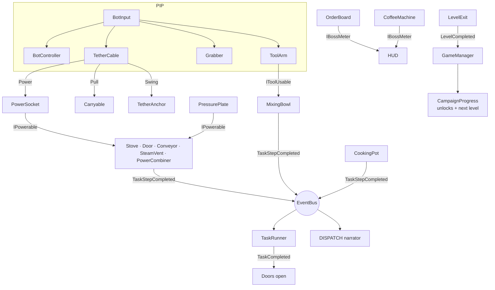

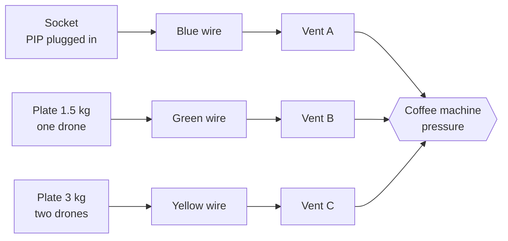

- **Tether Cable** attaches to any `TetherTarget`; the target decides the mode (`PowerSocket` = Power, `Carryable` = Pull,
  `TetherAnchor` = Swing). Power and Swing use a rope-length constraint, no joints.
- **Power** is `IPowerable.SetPowered(bool)`. Sockets and plates power whatever they list; `PowerCombiner` (AND/OR)
  merges inputs; `PowerWire` lights up so players can follow it.
- **Cooking**: `CookingPot` (boil) and `MixingBowl` (whisk) match their contents against `RecipeDefinition`s.
  `OrderBoard` spawns tickets with patience timers; `ServingHatch` fulfils them; `KitchenChaos` throws mishaps.
- **Tasks and story**: everything raises `TaskStepCompleted` / `NarrationCue` on a typed `EventBus`. `TaskRunner` ticks
  the checklist; `DispatchNarrator` plays DISPATCH's lines from a `DispatchScript` asset.
- **Levels are code**: `Assets/_Project/Editor/*Builder.cs` generate each scene from the `ChamberKit` helpers
  (rooms, sockets, plates, drones, stoves, sinks, pots, bowls, dispensers, the critic, the coffee machine...).

```
Assets/_Project/
  Scripts/  (RobotRescue.Runtime)
    Core/      EventBus, GameManager (pause, restart, next level), HUD interfaces
    Bots/      BotInput, BotController, BotCamera, TetherCable, Grabber, ToolArm, HelperDrone
    Tools/     ToolDefinition, ToolPickup, IToolUsable
    Puzzles/   TetherTarget + PowerSocket / Carryable / TetherAnchor, PressurePlate, Door, Conveyor, PowerWire, PowerCombiner...
    Tasks/     TaskDefinition, TaskRunner, step signals
      Cooking/ CookingPot, MixingBowl, Recipe/Ingredient definitions, OrderBoard, ServingHatch, KitchenChaos, CriticNPC...
      Rescue/  CoffeeMachine, SteamVent
    Campaign/  CampaignDefinition, CampaignProgress, LevelExit
    Narrative/ DispatchScript, DispatchNarrator
    UI/        PrototypeHUD, MainMenu, MenuCamera
  Editor/   (RobotRescue.Editor) ChamberKit (+Puzzles, Kitchen, Rooms), level builders, ProjectBuilder, BuildScript, Media/
tools/rr    Ubuntu/WSL helper
docs/       art (animated SVGs), media (rendered screenshots + GIFs), PROGRESS.md
```

## Roadmap

| Milestone | Status |
|---|---|
| 1. Core bot: movement, Tether (power / pull / swing), push / carry / throw, first cooking chamber | ✅ done |
| 2. Puzzle toolkit: Helper Drones, conveyors, wires, AND/OR gates, 3 test chambers | ✅ done |
| 3. Chapters 1-2 slice: Tool Arm + Whisk, orders, Coffee Crisis, Pasta Panic, menu, downloads | ✅ done, released in v0.3.0 |
| 4. Cute 3D look, personalities, open world, battery, breakable parts, climbing | ✅ builds in Unity · 🔧 playtest |
| 4b. Chapters 3-4 + Screwdriver | ✅ builds in Unity · 🔧 playtest |
| 7. Chapters 5-7 + Magnet | ✅ builds in Unity · 🔧 playtest |
| 7b. Chapter 8: Founders' Festival (finale) | ✅ builds in Unity · 🔧 playtest |
| Customizable bots | ✅ builds in Unity, filmed |
| Side call: The Pump House (power cells, counterweights, resets, hints) | ✅ self-test 21/21 · 🔧 playtest |
| Comfort rules: reserve battery, lost parts come home | 🔧 built 18 Oct, checks added to the self-test |
| 5. Co-op (2-4 bots, online + couch) | 🗺️ planned |
| 6. Rescue Rush (timed shuffled tasks, leaderboards) | 🗺️ planned |
| 8. Art, audio and polish pass | 🗺️ planned |

Details per milestone: [docs/PROGRESS.md](docs/PROGRESS.md).

## Status

- All 20 scenes build clean in Unity 6000.6.5f1 on the dev PC (18 Oct), and the level lint finds 0 issues.
- Feel and tuning numbers (speeds, cable length, order timers, battery drain) are first guesses: nobody has played the
  whole campaign start to finish yet. That's the next step.
- The toon look is procedural (rounded meshes, custom shaders); hand-made models and audio come in the polish milestone.
- The progress art in `docs/art/` is drawn by `tools/art/*.py` (`python3 tools/art/progress.py docs/art/progress.svg`),
  so the numbers are easy to update.
