<p align="center">
  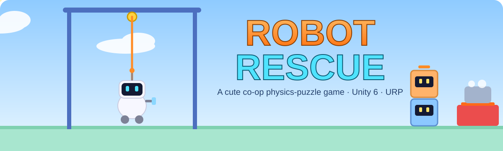
</p>

<p align="center">
  <a href="https://github.com/Normansrule/robot-rescue/releases/latest"></a>
  <a href="https://normansrule.github.io/robot-rescue/"></a>
  
  
</p>

**ROBOT RESCUE** is a cute co-op physics-puzzle game. You are **PIP**, the newest rescue bot at the Robot Rescue Bureau of
Brightwater. **DISPATCH** sends you out to save people from everyday disasters: pasta that won't cook, a coffee machine
that's about to blow, a food critic who's about to write a terrible review.

<p align="center">
  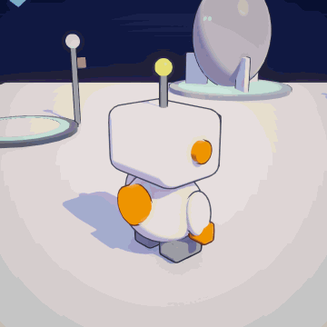
  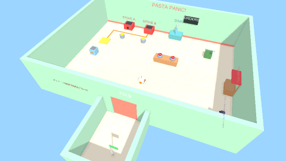
</p>

## Download and play

| Your computer | Download | How to start |
|---|---|---|
| **Windows** | [RobotRescue-Windows.zip](https://github.com/Normansrule/robot-rescue/releases/latest/download/RobotRescue-Windows.zip) | Unzip, double-click `RobotRescue.exe` (Windows may ask "run anyway?": More info > Run anyway) |
| **Mac** | [RobotRescue-Mac.zip](https://github.com/Normansrule/robot-rescue/releases/latest/download/RobotRescue-Mac.zip) | Unzip, right-click `RobotRescue.app` > Open the first time (it isn't signed). If macOS says it's damaged: `xattr -cr RobotRescue.app` |
| **Linux** | [RobotRescue-Linux.zip](https://github.com/Normansrule/robot-rescue/releases/latest/download/RobotRescue-Linux.zip) | `unzip RobotRescue-Linux.zip && ./RobotRescue-Linux/RobotRescue.x86_64` |
| **Any browser** | [**Play now**](https://normansrule.github.io/robot-rescue/) | Nothing to install. Chrome, Edge or Firefox on a computer works best |

All downloads are on the [Releases page](https://github.com/Normansrule/robot-rescue/releases). Progress saves automatically;
the main menu has **Continue** and **Choose a call**.

## How PIP works

PIP's **Tether Cable** does three jobs, depending on what you aim it at:

<p align="center"></p>

Plus a swappable **Tool Arm** (the Whisk arrives in Chapter 2), **Helper Drones** you can stack, carry and throw, and
push / carry / throw for everything else.

<p align="center">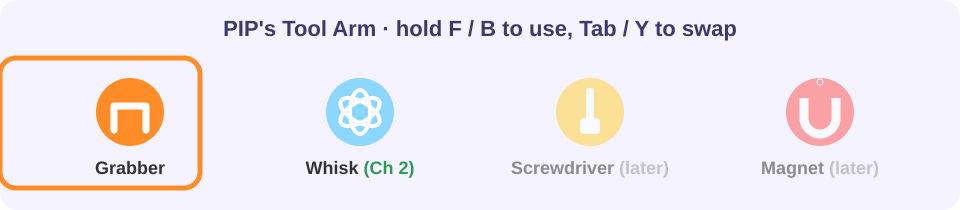</p>

## The levels

Every level is generated by a one-click builder inside Unity, so these are always the real thing.
(Screenshots and GIFs are rendered by `rr media`, see [below](#check-progress).)

| | |
|---|---|
| **Training 1: Stack 'Em Up**<br>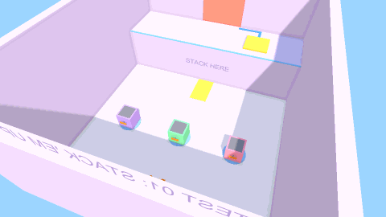 | **Training 2: Conveyor Caper**<br>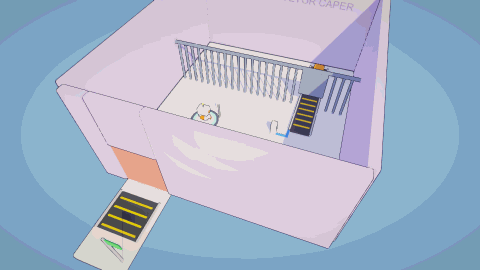 |
| **Training 3: Swing Shift**<br>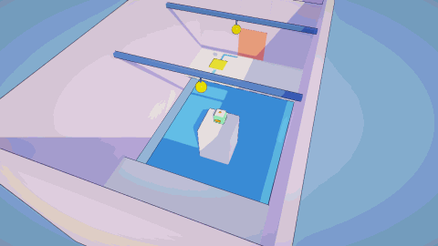 | **Big Rescue: Coffee Crisis**<br>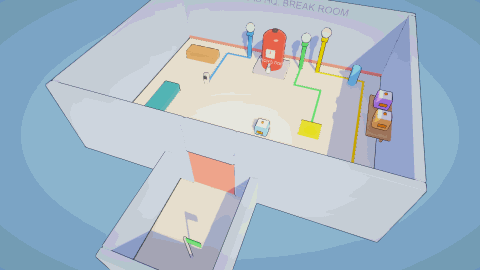 |
| **Call 2-1: Pasta Emergency**<br>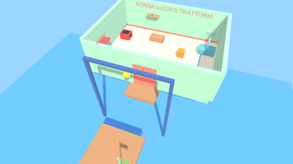 | **Call 2-2: Whisk Business**<br>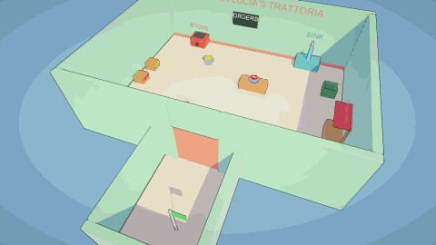 |

### Big Rescues

<p align="center"></p>

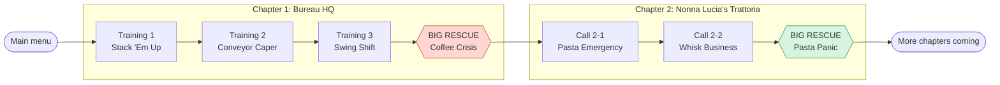

<details>
<summary><b>Walkthroughs (spoilers)</b></summary>

**Training 1: Stack 'Em Up.** Make stairs from the three drones (one on the floor, two stacked against the ledge) and
climb up. Tether-pull a drone up after you and park it on the plate: PIP alone is too light.

**Training 2: Conveyor Caper.** Plug into the blue socket so the belt carries the crate under the fence. Push the crate
onto the plate (one input of the AND gate), then plug into the orange socket by the door (the other input) and walk out
while still plugged in, against the treadmill.

**Training 3: Swing Shift.** Swing to the island, then to the far side. Tether-pull the stranded drone across the pit and
put it on the plate.

**Big Rescue: Coffee Crisis.** Pressure climbs on its own and each open vent bleeds some off. Green vent: put one drone
on its plate. Yellow vent: its plate needs two drones stacked; Tether-pull the two drones off the high shelf. Blue vent:
plug into its socket last. Hold all three open until the gauge settles.

**Call 2-1: Pasta Emergency.** Push the crate onto the sink's plate, fill the pot, Tether-pull the pasta off the high
shelf, put the pot on the stove and plug into it (you're the battery), serve at the hatch, then swing over the harbour.

**Call 2-2: Whisk Business.** Grab the Whisk from its stand. Tomato into the bowl, set it down, hold **F / B** to whisk.
Pasta into the pot, fill it at the sink, put it on the stove and plug in. Serve what the tickets ask for.

**Big Rescue: Pasta Panic.** Five tickets for Mr. Grumbleton. Stove A runs off your Tether, Stove B off the plate by
the west wall (park the drone on it), so you can cook two things at once. Ingredients ride in on the pantry belt.
Burnt pots go in the trash. Expect blown fuses (plug back in), rattling pots and a reversing belt. Three expired tickets
and he storms out.
</details>

## Controls

| Action | Keyboard / mouse | Gamepad |
|---|---|---|
| Move / look | WASD / mouse | Left stick / right stick |
| Jump (also: let go of a swing) | Space | A |
| Pick up / put down | E | X |
| Throw | Left mouse | RT |
| Fire / release Tether | Right mouse | LT |
| Reel in / out (swinging) | Q / Z | RB / LB |
| Use tool (hold) | F | B |
| Swap tool | Tab | Y |
| Pause | Esc / P | Start |
| Next call (after a win) | Enter | A |
| Restart | Backspace | Select |

## Ubuntu commands (copy and paste)

Everything goes through one small script, [`tools/rr`](tools/rr). These blocks work from **any folder** in a fresh
Ubuntu terminal. On Windows that's **WSL** (Start menu > "Ubuntu"); the game folder is then
`/mnt/c/Users/aleks/Desktop/Robot Rescue`.

### 1. One-time setup

```bash
sudo apt update && sudo apt install -y git git-lfs gh zip unzip python3 curl
bash "/mnt/c/Users/aleks/Desktop/Robot Rescue/tools/rr" install
source ~/.bashrc
rr help
```

After this, `rr` works in every new terminal, from any folder.

### 2. Put it on GitHub (first time creates the repo)

```bash
rr publish
```

It signs you in to GitHub if needed (follow the code it prints), creates the public repo `robot-rescue` on your account,
and pushes everything, art and all (big files go through Git LFS). Run the same command again any time to upload new
progress. Want another name? `RR_REPO=my-name rr publish`.

### 3. Make the downloads (Unity must be closed)

```bash
rr modules          # which platforms your Unity can build (add missing ones in Unity Hub > Installs > Add modules)
rr build all        # Windows + Linux + Mac + browser builds into Builds/
rr release 0.3.0    # zips them and publishes GitHub Release v0.3.0 (the README download links point here)
rr pages            # puts the browser build online at https://normansrule.github.io/robot-rescue/
```

### Check progress

```bash
rr progress         # levels built, screenshots, builds, recent commits, Unity compile errors
rr open             # open the project in Unity
rr log              # watch Unity's log live while you work (Ctrl+C stops)
rr levels           # rebuild every level + menu (Unity closed)
rr media            # re-render the screenshots + GIFs in this README (Unity closed)
rr gallery          # open the screenshots folder
rr snap             # screenshot your screen (e.g. Unity) into docs/progress/
rr play             # play your latest Windows build
rr web              # play the browser build at http://localhost:8080
```

<details>
<summary>On a different computer (no copy of the project yet)</summary>

```bash
sudo apt update && sudo apt install -y git git-lfs
git lfs install
git clone https://github.com/Normansrule/robot-rescue.git ~/robot-rescue
bash ~/robot-rescue/tools/rr install && source ~/.bashrc
rr progress
```
Building needs Unity 6000.6.5f1 (Unity Hub) on that computer; `rr` finds it in `~/Unity/Hub/Editor`, or set `RR_UNITY`.
</details>

<details>
<summary>Optional: cloud builds with GitHub Actions</summary>

[`.github/workflows/build.yml`](.github/workflows/build.yml) builds all four platforms on GitHub's servers, makes a
release and deploys the browser version to Pages. It only runs when you start it (Actions tab > Build game > Run
workflow) and needs Unity licence secrets first (`UNITY_LICENSE`, `UNITY_EMAIL`, `UNITY_PASSWORD`; see
[game.ci activation](https://game.ci/docs/github/activation)). If you use it for Pages, set Settings > Pages > Source to
"GitHub Actions" instead of the `gh-pages` branch that `rr pages` uses.
</details>

## Inside Unity

Open the project with **Unity 6000.6.5f1** (Unity Hub), then use the **Robot Rescue** menu:

| Menu item | What it does |
|---|---|
| **Build Everything** | Generates every level, the main menu, the campaign and Build Settings |
| Chapter 1 / Chapter 2 / Test Chambers / ... | Rebuild one level |
| **Capture README Media** | Renders `docs/media/*.png` + `*.gif` |
| **Build Game** > Windows / Linux / Mac / Browser / All | Player builds into `Builds/` |

Then open `Assets/_Project/Scenes/MainMenu` and press **Play**.

## How it's built

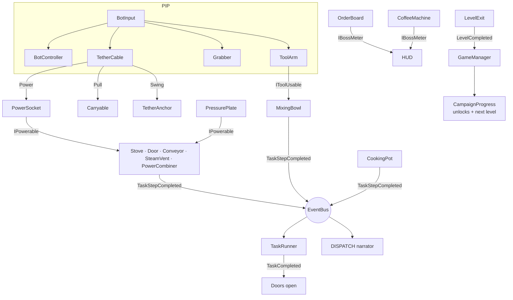

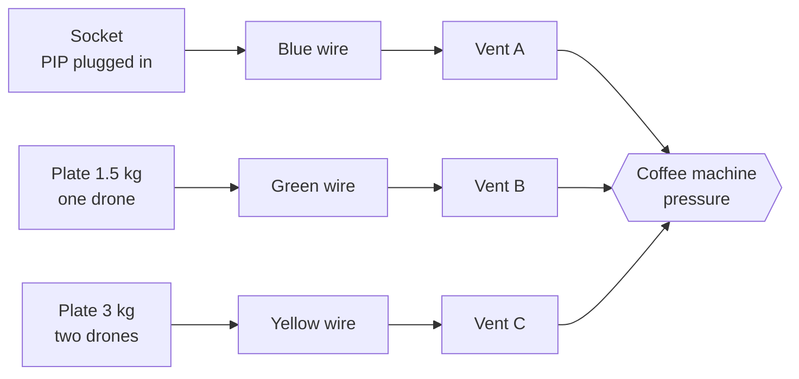

- **Tether Cable** attaches to any `TetherTarget`; the target decides the mode (`PowerSocket` = Power, `Carryable` = Pull,
  `TetherAnchor` = Swing). Power and Swing use a rope-length constraint, no joints.
- **Power** is `IPowerable.SetPowered(bool)`. Sockets and plates power whatever they list; `PowerCombiner` (AND/OR)
  merges inputs; `PowerWire` lights up so players can follow it.
- **Cooking**: `CookingPot` (boil) and `MixingBowl` (whisk) match their contents against `RecipeDefinition`s.
  `OrderBoard` spawns tickets with patience timers; `ServingHatch` fulfils them; `KitchenChaos` throws mishaps.
- **Tasks and story**: everything raises `TaskStepCompleted` / `NarrationCue` on a typed `EventBus`. `TaskRunner` ticks
  the checklist; `DispatchNarrator` plays DISPATCH's lines from a `DispatchScript` asset.
- **Levels are code**: `Assets/_Project/Editor/*Builder.cs` generate each scene from the `ChamberKit` helpers
  (rooms, sockets, plates, drones, stoves, sinks, pots, bowls, dispensers, the critic, the coffee machine...).

```
Assets/_Project/
  Scripts/  (RobotRescue.Runtime)
    Core/      EventBus, GameManager (pause, restart, next level), HUD interfaces
    Bots/      BotInput, BotController, BotCamera, TetherCable, Grabber, ToolArm, HelperDrone
    Tools/     ToolDefinition, ToolPickup, IToolUsable
    Puzzles/   TetherTarget + PowerSocket / Carryable / TetherAnchor, PressurePlate, Door, Conveyor, PowerWire, PowerCombiner...
    Tasks/     TaskDefinition, TaskRunner, step signals
      Cooking/ CookingPot, MixingBowl, Recipe/Ingredient definitions, OrderBoard, ServingHatch, KitchenChaos, CriticNPC...
      Rescue/  CoffeeMachine, SteamVent
    Campaign/  CampaignDefinition, CampaignProgress, LevelExit
    Narrative/ DispatchScript, DispatchNarrator
    UI/        PrototypeHUD, MainMenu, MenuCamera
  Editor/   (RobotRescue.Editor) ChamberKit (+Puzzles, Kitchen, Rooms), level builders, ProjectBuilder, BuildScript, Media/
tools/rr    Ubuntu/WSL helper
docs/       art (animated SVGs), media (rendered screenshots + GIFs), PROGRESS.md
```

## Roadmap

| Milestone | Status |
|---|---|
| 1. Core bot: movement, Tether (power / pull / swing), push / carry / throw, first cooking chamber | ✅ done |
| 2. Puzzle toolkit: Helper Drones, conveyors, wires, AND/OR gates, 3 test chambers | ✅ done |
| 3. Chapters 1–2 slice: Tool Arm + Whisk, orders, Coffee Crisis, Pasta Panic, menu, downloads | ✅ built, playtesting |
| 4. Chapters 3–4 + Screwdriver | ⏳ next |
| 5. Co-op (2–4 bots, online + couch) | ⏳ |
| 6. Rescue Rush (timed shuffled tasks, leaderboards) | ⏳ |
| 7. Chapters 5–8 + Magnet | ⏳ |
| 8. Art, audio and polish pass | ⏳ |

Details per milestone: [docs/PROGRESS.md](docs/PROGRESS.md).

## Status

- Scripts compile and every builder runs in Unity 6000.6.5f1 (checked on the dev PC).
- Feel and tuning numbers (speeds, cable length, order timers, coffee pressure) are first guesses and still being playtested.
- Art is deliberately greybox (primitives, signs, an IMGUI HUD); the polish milestone replaces it.
